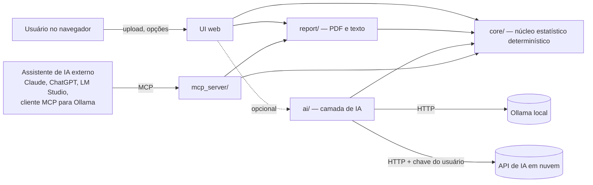

# EnsaIA — Especificação do sistema

> **Nome do sistema:** EnsaIA (pacote Python: `ensaia`). A identidade visual e as cores serão definidas depois (`report/theme.py` e tema da UI).
> **Contexto:** sistema desenvolvido como parte do TCC "Abordagem acessível para delineamento experimental e análise de dados químicos com modelos preditivos" (Sistemas de Informação — UFRA). Autores: Gabriel e Gustavo Neves da Paz Rafael. Orientadora: Profa. Dra. Luiza Helena da Silva Martins.
> **Versão deste documento:** 0.4 (nome EnsaIA; interface em NiceGUI; leveza como requisito medido; MCP como última fase)

---

## 0. Como usar este documento (instruções para a IA geradora de código)

Este arquivo é a fonte de verdade do projeto. Ao gerar código a partir dele:

1. **Gere por fases** (seção 18), nunca o sistema inteiro de uma vez. Cada fase termina com testes passando.
2. **O núcleo estatístico (`core/`) é determinístico e não depende de IA, UI ou MCP.** Nenhuma conta estatística pode ser feita por LLM.
3. **Respeite o contrato de dados** da seção 10. UI, MCP e relatório consomem o mesmo objeto `AnalysisResult`.
4. **Não invente fórmulas.** Use as definições da seção 9. Em caso de dúvida, pergunte em vez de supor.
5. **Nada é gravado em disco ou banco.** Arquivos são lidos em memória (`BytesIO`) e descartados ao fim da sessão (seção 15).
6. **Idioma:** identificadores de código em inglês; textos da interface, mensagens, relatórios e descrições das ferramentas MCP em português do Brasil.
7. **Números no padrão brasileiro na saída** (vírgula decimal na UI e no PDF); internamente, `float` normal.
8. Itens marcados com **[DECISÃO PENDENTE]** devem ser confirmados antes de implementar.
9. **Leveza é requisito, não detalhe.** Não adicione dependência de execução fora da lista da seção 7.4 sem justificar e medir o impacto na memória (seção 16). Prefira a biblioteca padrão e poucas linhas de código próprio a um pacote grande.

---

## 1. Visão geral

### 1.1 Problema
Análises de Planejamento de Experimentos (DOE) em química dependem, na prática, de softwares pagos (Statistica, Minitab, Design-Expert). Isso limita estudantes e laboratórios com pouco recurso. Alternativas gratuitas existem (R, Python, Protimiza, planilhas), mas exigem conhecimento de programação ou estatística.

### 1.2 Proposta
Um sistema **web, gratuito e sem armazenamento de dados** em que o usuário:

1. arrasta a planilha do experimento para uma *dropzone*;
2. indica quais colunas são fatores e respostas;
3. marca, por *checkbox*, as análises de DOE que deseja;
4. vê os resultados (tabelas e gráficos) na tela;
5. baixa um **relatório PDF padronizado**;
6. opcionalmente, obtém uma **explicação em linguagem natural** gerada por IA — paga (nuvem) ou **gratuita e local**, rodando no próprio computador.

Além da interface web, o sistema expõe um **servidor MCP** (Model Context Protocol) para que qualquer assistente de IA compatível (Claude, ChatGPT, LM Studio, clientes para Ollama etc.) use as mesmas análises como ferramentas.

### 1.3 Público-alvo
Estudantes e pesquisadores de química, alimentos, engenharia e áreas afins, sem formação em programação, que precisam analisar fatoriais e superfícies de resposta.

### 1.4 Hipótese do TCC ligada ao sistema
Os resultados numéricos do `EnsaIA` reproduzem os de softwares pagos publicados em artigos (Artigos Alvo) dentro de tolerâncias definidas (seção 14). Além disso, a camada de IA produz explicações fiéis aos números calculados.

---

## 2. Princípios e restrições

| # | Princípio | Consequência prática |
|---|-----------|----------------------|
| P1 | **Sem armazenamento** | Sem banco de dados, sem gravação em disco, sem logs com dados do usuário. Tudo vive na memória da sessão. |
| P2 | **Números vêm do código, texto vem da IA** | O núcleo calcula tudo. A IA só redige e explica a partir de um JSON de fatos. Toda afirmação numérica da IA é checada (seção 12.5). |
| P3 | **Funciona sem IA** | Todas as análises e o PDF funcionam sem nenhum modelo de linguagem. A IA é uma camada opcional. |
| P4 | **Gratuito de ponta a ponta** | Só bibliotecas livres. A IA gratuita pode ser local (Ollama/LM Studio) ou por "copiar e colar" do prompt. |
| P5 | **Leve por projeto** | Um único processo; poucas dependências (seção 7.4); sem pandas, statsmodels, Plotly ou LangChain em produção; importação tardia (*lazy import*) do que é pesado; metas de memória verificadas automaticamente (seção 16). Cabe com folga em 512 MB. |
| P6 | **Reprodutível** | O relatório traz o hash SHA-256 do arquivo de entrada, as versões do sistema e das bibliotecas e todas as opções escolhidas. |
| P7 | **Um núcleo, várias portas** | UI web, servidor MCP e geração de PDF chamam o mesmo `core/`. Nenhuma lógica estatística fica duplicada. |

> **Observação de arquitetura:** o processamento é feito pelo `core/` em Python. O MCP é uma *porta de acesso* a esse núcleo para assistentes de IA. A interface web chama o núcleo diretamente, sem passar por MCP, porque é mais rápido e usa menos memória. Assim, "processamento via MCP" significa que **a IA acessa o processamento por MCP**, e não que a IA faz as contas.

---

## 3. Escopo

### 3.1 Dentro do MVP
- Upload por *dropzone*: `.csv`, `.tsv`, `.txt` (delimitado), `.xlsx`, `.xls`, `.ods`.
- Mapeamento de colunas: fatores, respostas e (opcional) ordem de execução e bloco.
- Codificação automática de fatores (valores reais ↔ codificados).
- Identificação do tipo de planejamento: fatorial completo 2^k, fatorial fracionário 2^(k−p), DCC/DCCR, Box-Behnken, 3^k e "genérico".
- Análises selecionáveis (seção 9).
- Gráficos interativos na tela e estáticos no PDF.
- Relatório PDF padronizado com as análises marcadas.
- Exportação do resultado em JSON.
- Servidor MCP com ferramentas, recursos e prompts.
- Texto explicativo por IA: (a) modelo de texto sem IA, (b) "copiar prompt", (c) IA local via Ollama, (d) IA em nuvem com chave do próprio usuário (BYOK).

### 3.2 Fora do MVP (futuro)
- Geração de novos planejamentos (matriz de ensaios a executar).
- Planejamentos de mistura (Scheffé, simplex).
- Doehlert.
- Blocos com análise de efeito de bloco.
- Contas de usuário, histórico e colaboração (conflitam com P1).
- Internacionalização (inglês/espanhol).

---

## 4. Fluxo do usuário (interface web)

```
[1] Enviar arquivo  →  [2] Conferir dados  →  [3] Mapear colunas  →  [4] Escolher análises
        →  [5] Ver resultados  →  [6] (opcional) Explicação por IA  →  [7] Baixar PDF / JSON
```

1. **Enviar arquivo:** *dropzone* ("Arraste sua planilha aqui ou clique para escolher"). Mostra os formatos aceitos e o limite de tamanho. Se o arquivo tiver várias abas, pergunta qual usar.
2. **Conferir dados:** prévia da tabela (até 50 linhas), com separador, decimal e codificação detectados, que podem ser corrigidos.
3. **Mapear colunas:** para cada coluna, escolher *Fator*, *Resposta*, *Ordem*, *Bloco* ou *Ignorar*. Há sugestão automática (seção 8.3). Para fatores, informar unidade (opcional) e se os valores já estão codificados.
4. **Escolher análises:** *checkboxes* agrupados (seção 9), com as opções compatíveis com o planejamento detectado já pré-marcadas. As indisponíveis aparecem desabilitadas, com um *tooltip* explicando o motivo (ex.: "Falta de ajuste exige réplicas no ponto central").
   - Opções avançadas: nível de significância α (padrão 0,05; permitir 0,10), termo de erro (resíduo ou erro puro), tipo de modelo (linear, com interações, quadrático) e termos a excluir.
5. **Ver resultados:** abas ou seções por análise. Cada tabela e cada gráfico tem um ícone "o que é isto?" com explicação curta.
6. **Explicação por IA (opcional):** escolher o provedor (seção 12) e gerar o texto por seção do relatório.
7. **Baixar:** botão "Baixar relatório (PDF)" e botão "Baixar resultados (JSON)". Um aviso fixo diz: *"Seus dados não são armazenados. Ao fechar a página, tudo é descartado."*

---

## 5. Requisitos funcionais

| ID | Requisito | Critério de aceite |
|----|-----------|--------------------|
| RF-01 | Receber arquivo por *drag-and-drop* ou seleção | Aceita os formatos da 3.1 até 5 MB; rejeita os demais com mensagem clara |
| RF-02 | Detectar separador, decimal e codificação | CSV com `;` e vírgula decimal (padrão brasileiro) é lido corretamente sem ajuste manual |
| RF-03 | Escolher aba de planilhas com várias abas | Lista as abas e lê a escolhida |
| RF-04 | Mapear colunas com sugestão automática | Colunas com valores em {−1, 0, +1, ±α} são sugeridas como fatores codificados |
| RF-05 | Codificar e decodificar fatores | Para DCCR, identifica os níveis ±1 corretamente, sem confundi-los com os axiais |
| RF-06 | Identificar o tipo de planejamento | Classifica corretamente os datasets de teste (seção 14.3) |
| RF-07 | Executar as análises marcadas | Só executa o que foi marcado; análises incompatíveis ficam desabilitadas e com explicação |
| RF-08 | Mostrar tabelas e gráficos interativos | Tabelas com formatação pt-BR; gráficos com zoom e *hover* |
| RF-09 | Permitir ajuste do modelo | Usuário remove termos e reajusta; o sistema avisa quando a hierarquia do modelo é violada |
| RF-10 | Otimizar uma ou mais respostas | Desejabilidade com metas por resposta (maximizar, minimizar, alvo) |
| RF-11 | Gerar PDF padronizado | PDF contém apenas as seções marcadas, na ordem da seção 13 |
| RF-12 | Exportar JSON | JSON segue o schema da seção 10 e valida com Pydantic |
| RF-13 | Texto sem IA (modelo de texto) | Gera texto interpretativo com base em regras, sempre disponível |
| RF-14 | Texto com IA | Suporta "copiar prompt", Ollama local e nuvem com chave do usuário |
| RF-15 | Checar fidelidade do texto da IA | Todo número do texto gerado é rastreável ao JSON de fatos; divergências são destacadas |
| RF-16 | Servidor MCP (fase F9, a última) | Expõe as ferramentas da seção 11 via `stdio` e HTTP (*streamable HTTP*) |
| RF-17 | Aviso de privacidade | Visível na tela inicial e no rodapé do PDF |
| RF-18 | Dados de exemplo | Botão "Usar dados de exemplo" carrega um dataset público (ex.: Café com Quimiometria) |

---

## 6. Requisitos não funcionais

| ID | Requisito | Meta |
|----|-----------|------|
| RNF-01 | Memória | Ocioso ≤ 150 MB; pico ≤ 300 MB numa análise completa com PDF (verificado no CI) |
| RNF-02 | Desempenho | Análise completa de um DCCR com 3 fatores e 17 ensaios em < 2 s, sem IA |
| RNF-03 | Privacidade | Nenhuma escrita em disco com dados do usuário; nenhum log com conteúdo de dados |
| RNF-04 | Acessibilidade | Contraste AA, navegação por teclado, textos alternativos nos gráficos, linguagem simples |
| RNF-05 | Responsividade | Utilizável em notebook (≥ 1280 px); leitura aceitável no celular |
| RNF-06 | Qualidade | Cobertura de testes ≥ 80% em `core/`; `ruff` sem erros; tipagem com `mypy` no `core/` |
| RNF-07 | Reprodutibilidade | Mesmo arquivo + mesmas opções = mesmo JSON (exceto timestamp) |
| RNF-08 | Portabilidade | Roda localmente com `uv run` ou Docker; roda em hospedagem de 512 MB |
| RNF-09 | Licença | Código aberto (sugestão: MIT) **[DECISÃO PENDENTE]** |
| RNF-10 | Tamanho da imagem | Imagem Docker ≤ 300 MB |
| RNF-11 | Peso no navegador | Primeira carga ≤ 2 MB; bibliotecas de gráfico 3D só carregam quando a seção de superfície é aberta |
| RNF-12 | Inicialização | Servidor pronto em ≤ 5 s (importante em hospedagens que "adormecem" o app) |

---

## 7. Arquitetura

### 7.1 Visão de componentes



- **`core/`**: leitura de arquivos, codificação, detecção de planejamento, modelos, ANOVA, resíduos, superfície, otimização. Funções puras que recebem uma `Table` (estrutura própria com arrays numpy, sem pandas) e opções e devolvem modelos Pydantic.
- **`report/`**: monta o PDF (fpdf2; matplotlib carregado só quando um PDF é pedido) e o texto por modelo de texto (Jinja2).
- **`ai/`**: monta prompts (Jinja2), chama o LLM por HTTP (`httpx`, API compatível com OpenAI) e checa fidelidade. Sem LangChain em produção (seção 12.4).
- **`mcp_server/`**: adapta as funções do `core/` e do `report/` para ferramentas MCP.
- **`ui/`**: só apresentação. Não contém contas.

### 7.2 Processo único em produção
Para caber em 512 MB, **UI e servidor MCP HTTP rodam no mesmo processo ASGI (FastAPI/Uvicorn, 1 worker)**:

```
uvicorn app.main:app  ─┬─ /          → UI web
                       ├─ /api/mcp   → servidor MCP (streamable HTTP)
                       └─ /health    → verificação de saúde
```

Montagem: um app FastAPI cujo `lifespan` inicia o gerenciador de sessões do servidor MCP; o app HTTP do MCP montado em `/api`; a NiceGUI acoplada ao mesmo app com `ui.run_with`. Esboço (conferir os nomes na versão do SDK fixada no `pyproject.toml`, porque a v2 do SDK oficial renomeou classes):

```python
from contextlib import asynccontextmanager
from fastapi import FastAPI
from nicegui import ui
from ensaia.mcp_server.server import mcp   # servidor MCP em modo sem estado

@asynccontextmanager
async def lifespan(app: FastAPI):
    async with mcp.session_manager.run():   # obrigatório ao montar o MCP em outro app
        yield

app = FastAPI(lifespan=lifespan)
app.mount("/api", mcp.streamable_http_app())   # endpoint final: /api/mcp
ui.run_with(app, title="EnsaIA")               # NiceGUI no mesmo processo
```

Não montar o MCP em `/`, para não encobrir as páginas da UI.

Para uso **local e privado**, o mesmo servidor MCP roda por `stdio` (ex.: `uvx ensaia-mcp`), sem internet.

### 7.3 Framework de interface: NiceGUI (decidido)

Motivos: roda sobre FastAPI, o que permite **um único processo** com a UI e o servidor MCP; atualiza só o que muda (não reexecuta o script a cada clique, como o Streamlit); já traz a *dropzone* (`ui.upload`), tabelas e o ECharts embutidos; e permite personalizar o visual (Quasar + Tailwind) quando a identidade do sistema for criada.

**Regras para manter a interface leve:**
- **Gráficos só com `ui.echart`** (ECharts já vem com a NiceGUI). Superfícies 3D com echarts-gl (`enable_3d=True`), carregado só quando a seção de superfície é aberta. Não instalar o pacote `plotly`.
- **Tabelas com `ui.table` paginada** (até 50 linhas por página). Não usar AG Grid.
- A NiceGUI mantém no servidor a árvore de elementos de cada aba aberta. Por isso: criar os elementos de resultado só quando a seção é aberta (abas ou `ui.expansion` com carregamento sob demanda), limpar tudo ao trocar de arquivo e manter a página enxuta.
- Superfícies e contornos com grade de 25 × 25 pontos (suficiente visualmente e barato).
- `reconnect_timeout` curto e limpeza do estado da sessão ao desconectar.
- Nada de CSS ou JS externos pesados; usar o que Quasar e Tailwind já oferecem.
- Em produção: sem `reload=True` e sem modo nativo (pywebview).

### 7.4 Orçamento de dependências

**Produção** (lista fechada; qualquer inclusão passa pela regra 9 da seção 0):

| Pacote | Para quê | Observação |
|---|---|---|
| `nicegui` | UI e servidor web | Já traz FastAPI, Uvicorn, Pydantic e Jinja2 |
| `mcp` (SDK oficial) | Servidor MCP | Já traz `httpx`, usado também para chamar LLMs |
| `numpy` | Álgebra linear (MQO via QR) | — |
| `scipy` | Distribuições t e F, Shapiro-Wilk, otimização | Importar só `scipy.stats` e `scipy.optimize`, e só quando necessário |
| `openpyxl` | Leitura de `.xlsx` | Modo somente leitura |
| `xlrd` | Leitura de `.xls` | — |
| `odfpy` | Leitura de `.ods` | — |
| `fpdf2` | Geração do PDF | Leve, sem dependências de sistema |
| `matplotlib` | Gráficos estáticos do PDF | Importação tardia (só ao gerar PDF) |

**Somente desenvolvimento e testes** (extra `[dev]`): `pytest`, `pytest-cov`, `ruff`, `mypy`, `psutil` (medição de memória) e **`statsmodels` + `pandas` como oráculo** de conferência nos testes (seção 14.4).

**Fora do projeto em produção, e por quê:**
- `pandas`: os datasets de DOE têm dezenas de linhas; `csv` da biblioteca padrão + `openpyxl` bastam, e a economia é de dezenas de MB de RAM.
- `statsmodels`: MQO e ANOVA de DOE são poucas fórmulas (seção 9). Implementar com numpy deixa as contas transparentes, o que é bom para a monografia, e o statsmodels passa a servir de oráculo nos testes.
- `plotly`: o ECharts já vem com a NiceGUI e cobre 2D e 3D.
- `langchain`: um adaptador HTTP próprio de ~100 linhas cobre Ollama, LM Studio e APIs em nuvem (seção 12.4).
- `fastmcp` (pacote independente): o SDK oficial já inclui o necessário, com menos dependências.

---

## 8. Entrada de dados

### 8.1 Formatos e leitura

| Extensão | Leitor | Observações |
|---|---|---|
| `.csv`, `.tsv`, `.txt` | `csv` (biblioteca padrão) | Detectar separador (`csv.Sniffer`: `;`, `,`, `\t`), decimal (`,` ou `.`) e codificação (`utf-8`, `utf-8-sig`, `latin-1`) |
| `.xlsx` | `openpyxl.load_workbook(read_only=True, data_only=True)` | Modo somente leitura; macros e fórmulas nunca são executadas; usa o valor em cache |
| `.xls` | `xlrd` | Formato antigo |
| `.ods` | `odfpy` | LibreOffice |

Regras:
- Limite de **5 MB** e **10 000 linhas**. Planejamentos reais têm de 8 a 100 ensaios; o limite evita abuso de memória.
- Linhas totalmente vazias são descartadas. Colunas sem cabeçalho recebem `coluna_1`, `coluna_2`...
- Números com vírgula decimal em células de texto são convertidos (`"12,5"` → `12.5`).
- Todos os leitores devolvem a mesma estrutura interna `Table`: nomes das colunas + colunas como `numpy.ndarray` (numéricas) ou listas de texto. Sem pandas.
- Leitura sempre a partir de `BytesIO`, nunca de caminho em disco (exceto no modo MCP `stdio`, em que o usuário pode indicar um caminho local — seção 11).

### 8.2 Formato esperado da planilha
Uma linha por ensaio e uma coluna por fator ou resposta. Exemplo:

| Ensaio | Temperatura (°C) | Tempo (min) | Etanol (%) | Rendimento (%) |
|---|---|---|---|---|
| 1 | 40 | 10 | 50 | 12,3 |
| 2 | 60 | 10 | 50 | 15,1 |
| … | … | … | … | … |

### 8.3 Sugestão automática de mapeamento
- Coluna com valores inteiros sequenciais 1..n e nome parecido com "ensaio", "exp", "run" ou "ordem" → *Ordem*.
- Coluna com poucos níveis distintos (≤ 5) → candidata a *Fator*.
- Coluna com muitos valores distintos e contínuos → candidata a *Resposta*.
- Coluna cujos valores estão todos em {−α, −1, 0, +1, +α} → fator **já codificado**.

### 8.4 Codificação de fatores
- Fórmula: `x_cod = (x_real − centro) / passo`, com `centro = média dos níveis ±1` e `passo = (nível(+1) − nível(−1)) / 2`.
- **2 ou 3 níveis:** ±1 = mínimo e máximo.
- **5 níveis (DCCR):** ±1 são o 2º e o 4º níveis ordenados; o 1º e o 5º são ±α. Validar `α ≈ (2^k)^(1/4)` (1,414 para k = 2; 1,682 para k = 3; 2,000 para k = 4) e avisar se não bater. Também aceitar α de face centrada (1) ou outros valores informados pelo usuário.
- O usuário pode sobrescrever centro e passo manualmente.

---

## 9. Catálogo de análises (as *checkboxes*)

Cada análise tem um identificador, pré-condições e saídas. A UI habilita cada *checkbox* apenas quando as pré-condições são atendidas.

### Grupo A — Dados e planejamento
| ID | Análise | Pré-condição | Saídas |
|---|---|---|---|
| A1 | Estatística descritiva | — | n, média, desvio, mín., máx., CV por resposta |
| A2 | Identificação do planejamento | ≥ 1 fator | Tipo, k, nº de ensaios, pontos centrais, α, ortogonalidade, avisos |
| A3 | Matriz codificada | ≥ 1 fator | Tabela real × codificada |

### Grupo B — Fatoriais (triagem)
| ID | Análise | Pré-condição | Saídas |
|---|---|---|---|
| B1 | Efeitos principais e interações | Fatorial 2 níveis (± pontos centrais) | Efeito = 2 × coeficiente codificado; erro-padrão; t; p |
| B2 | Gráfico de Pareto dos efeitos padronizados | B1 | Barras de \|t\| com linha do t crítico |
| B3 | Gráfico normal (ou meio-normal) dos efeitos | B1 sem réplicas | Método de Lenth (PSE) para destacar efeitos ativos |
| B4 | Gráficos de efeitos principais e de interação | B1 | Médias por nível |
| B5 | Teste de curvatura | Fatorial com ≥ 2 pontos centrais | `SQ_curv = n_F·n_C·(ȳ_F − ȳ_C)² / (n_F + n_C)`, F e p |

### Grupo C — Modelo de regressão e ANOVA
| ID | Análise | Pré-condição | Saídas |
|---|---|---|---|
| C1 | Ajuste do modelo (MQO/OLS) | nº de ensaios > nº de termos | Coeficientes (codificados e reais), erro-padrão, t, p, IC 95% |
| C2 | ANOVA | C1 | Tabela: Regressão, Resíduo, Falta de ajuste, Erro puro, Total; GL, SQ, MQ, F, p |
| C3 | Coeficientes de determinação | C1 | R², R² ajustado, R² de predição (PRESS) |
| C4 | Teste de falta de ajuste | Réplicas (em geral no ponto central) | F_faj = MQ_faj / MQ_ep, p |
| C5 | Equação do modelo | C1 | Codificada e em unidades reais, com e sem termos não significativos |
| C6 | Preditos × observados | C1 | Tabela e gráfico com linha y = x; erro relativo por ensaio |

Implementação: MQO com numpy (decomposição QR ou `numpy.linalg.lstsq`); alavancagem hᵢᵢ pela diagonal da matriz chapéu obtida da QR; p-valores com `scipy.stats.t` e `scipy.stats.f`. Sem statsmodels em produção.

Definições (usar exatamente estas):
- `SQ_T = Σ(yᵢ − ȳ)²`; `SQ_R = Σ(ŷᵢ − ȳ)²`; `SQ_res = Σ(yᵢ − ŷᵢ)²`; `SQ_res = SQ_faj + SQ_ep`.
- `R² = SQ_R / SQ_T`; `R²_aj = 1 − (SQ_res/GL_res) / (SQ_T/GL_T)`; `R²_pred = 1 − PRESS / SQ_T`, com `PRESS = Σ(eᵢ / (1 − hᵢᵢ))²`.
- F da regressão: `F = MQ_R / MQ_res`. Mostrar também o **F tabelado** e a razão `F_calc / F_tab`, muito usada na literatura brasileira (Barros Neto et al.; Rodrigues e Iemma).
- **Termo de erro para os testes t dos coeficientes (opção do usuário):**
  - `residuo` (padrão; comportamento tipo Minitab): usa MQ_res com GL_res;
  - `erro_puro` (comportamento comum em análises no Statistica e em artigos brasileiros): usa MQ_ep com GL_ep.
  - **Isto é essencial para a validação:** ao comparar com um Artigo Alvo, usar o mesmo termo de erro que o artigo.

### Grupo D — Diagnóstico
| ID | Análise | Pré-condição | Saídas |
|---|---|---|---|
| D1 | Resíduos × preditos | C1 | Gráfico |
| D2 | Normalidade dos resíduos | C1 | Gráfico Q-Q e teste de Shapiro-Wilk |
| D3 | Resíduos × ordem de execução | C1 + coluna *Ordem* | Gráfico |
| D4 | Pontos influentes | C1 | Resíduos *studentizados*, alavancagem hᵢᵢ, distância de Cook |

### Grupo E — Superfície de resposta e otimização
| ID | Análise | Pré-condição | Saídas |
|---|---|---|---|
| E1 | Superfície de resposta 3D | Modelo com ≥ 2 fatores | ECharts interativo na UI (echarts-gl) e matplotlib no PDF; demais fatores fixos no centro ou em valor escolhido |
| E2 | Curvas de contorno | Idem | Idem |
| E3 | Ponto estacionário e análise canônica | Modelo quadrático | `x_s = −½·B⁻¹·b`; autovalores de B → máximo, mínimo ou sela; avisar se x_s está fora da região experimental |
| E4 | Otimização de uma resposta | C1 | Máximo ou mínimo dentro da região (limites codificados, padrão [−α, +α]); busca com vários pontos de partida (`scipy.optimize.minimize`, L-BFGS-B) mais grade de conferência |
| E5 | Desejabilidade (várias respostas) | ≥ 2 respostas com modelo | Função de Derringer e Suich (1980): dᵢ por resposta (maximizar, minimizar ou alvo; limites inferior, superior e alvo; pesos s, t) e `D = (Πdᵢ)^(1/m)`; condição ótima, valores previstos e perfil de desejabilidade |

### Regras gerais
- α de significância padrão = 0,05; permitir 0,10 (comum em DCCR na literatura brasileira).
- **Hierarquia do modelo:** ao remover um termo principal que participa de interação ou termo quadrático significativo, avisar (não bloquear).
- **Redução do modelo:** opção "remover termos não significativos e reajustar" (eliminação *backward*, respeitando a hierarquia), e opção de exclusão manual para reproduzir o modelo de um artigo.
- Toda análise pode gerar **avisos** (lista de strings) que vão para a UI, o JSON e o PDF.

---

## 10. Contrato de dados (`AnalysisResult`)

Todos os resultados usam modelos **Pydantic v2** em `core/schemas.py`. O JSON exportado, a resposta das ferramentas MCP e a entrada do relatório e da IA são o mesmo objeto. Exemplo resumido:

```json
{
  "schema_version": "1.0",
  "meta": {
    "system_version": "0.1.0",
    "generated_at": "2026-10-01T12:00:00-03:00",
    "input_file": "extracao.xlsx",
    "input_sha256": "3f2a…",
    "library_versions": {"numpy": "…", "scipy": "…", "nicegui": "…", "mcp": "…"},
    "options": {"alpha": 0.05, "error_term": "residual", "model_type": "quadratic", "excluded_terms": []}
  },
  "design": {
    "type": "CCRD",
    "k": 3,
    "n_runs": 17,
    "n_center": 3,
    "alpha_axial": 1.682,
    "factors": [
      {"name": "X1", "column": "Temperatura", "unit": "°C", "center": 50.0, "step": 10.0, "levels_real": [33.2, 40, 50, 60, 66.8]}
    ],
    "warnings": []
  },
  "responses": [
    {
      "name": "Rendimento",
      "model": {
        "terms": [
          {"term": "Intercept", "coef_coded": 15.2, "coef_real": 3.1, "std_error": 0.4, "t": 38.0, "p": 0.0001, "ci95": [14.3, 16.1], "significant": true},
          {"term": "X1", "coef_coded": 1.8, "coef_real": 0.18, "std_error": 0.3, "t": 6.0, "p": 0.0005, "ci95": [1.1, 2.5], "significant": true}
        ],
        "equation_coded": "ŷ = 15,20 + 1,80·X1 + …",
        "equation_real": "ŷ = 3,10 + 0,18·Temperatura + …"
      },
      "anova": {
        "rows": [
          {"source": "Regressão", "df": 9, "ss": 120.5, "ms": 13.39, "f": 25.1, "p": 0.0002},
          {"source": "Resíduo", "df": 7, "ss": 3.73, "ms": 0.53, "f": null, "p": null},
          {"source": "Falta de ajuste", "df": 5, "ss": 3.10, "ms": 0.62, "f": 1.97, "p": 0.37},
          {"source": "Erro puro", "df": 2, "ss": 0.63, "ms": 0.315, "f": null, "p": null},
          {"source": "Total", "df": 16, "ss": 124.23, "ms": null, "f": null, "p": null}
        ],
        "r2": 0.970, "r2_adj": 0.932, "r2_pred": 0.81,
        "f_tab": 3.68, "f_ratio": 6.8
      },
      "residuals": {"shapiro_w": 0.95, "shapiro_p": 0.41, "influential_runs": []},
      "stationary_point": {"coded": [0.3, -0.1, 0.5], "real": [53.0, 9.5, 55.0], "nature": "máximo", "inside_region": true, "predicted": 16.4},
      "warnings": []
    }
  ],
  "optimization": {
    "method": "desirability",
    "goals": [{"response": "Rendimento", "goal": "maximize", "low": 10, "high": 18, "weight": 1}],
    "optimum_coded": [0.4, 0.0, 0.6],
    "optimum_real": [54.0, 10.0, 56.0],
    "predicted": {"Rendimento": 16.3},
    "D": 0.79
  },
  "facts": ["O fator Temperatura (X1) é significativo (p = 0,0005 < 0,05).", "…"]
}
```

O campo **`facts`** traz frases prontas e verificadas, geradas por regras no `core/`. É a principal entrada da IA local (seção 12).

---

## 11. Servidor MCP (implementado por último — fase F9)

### 11.1 Biblioteca e transportes
- **SDK oficial do MCP para Python** (pacote `mcp`), mais enxuto que o pacote independente `fastmcp`. Usar o modo HTTP **sem estado** (`stateless_http=True` ou o equivalente na versão). A v2 do SDK mudou nomes de classes: seguir a documentação da versão fixada.
- **Transportes:**
  - `stdio`: uso local e totalmente privado. Comando: `ensaia-mcp` (instalável com `uvx` ou `pip`).
  - *Streamable HTTP* em `/api/mcp`: montado no mesmo app FastAPI da UI (seção 7.2), para assistentes em nuvem que exigem URL pública HTTPS.
- **Sem estado:** toda ferramenta recebe os dados no próprio chamado. Datasets de DOE são pequenos (dezenas de linhas), então repassar os dados é barato e dispensa armazenamento (P1).

### 11.2 Ferramentas (*tools*)
Descrições em pt-BR, curtas e com exemplo, porque modelos pequenos dependem muito delas.

| Ferramenta | Entrada (resumo) | Saída |
|---|---|---|
| `read_table` | `data_csv: str` **ou** `file_base64 + filename` **ou** `path` (só em `stdio`) | Colunas, tipos, prévia, separador e decimal detectados, sugestão de mapeamento |
| `detect_design` | `data`, `factors`, `responses` | Seção `design` do `AnalysisResult` |
| `fit_model` | `data`, `factors`, `response`, `model_type`, `excluded_terms`, `error_term`, `alpha` | Coeficientes + ANOVA + R² |
| `compute_effects` | idem, para fatoriais | Efeitos, Pareto (dados), Lenth |
| `check_residuals` | idem | Diagnóstico de resíduos |
| `find_stationary_point` | idem | Ponto estacionário e natureza |
| `optimize` | `data`, `factors`, `responses`, `goals` | Ótimo e desejabilidade |
| **`run_full_analysis`** | `data`, mapeamento, lista de análises (IDs da seção 9), opções | **`AnalysisResult` completo** — uma única chamada, ideal para modelos pequenos |
| `render_pdf` | `AnalysisResult`, seções, texto opcional | PDF em base64 (recurso embutido) |
| `verify_text` | `text`, `AnalysisResult` | Relatório de fidelidade (seção 12.5) |

### 11.3 Recursos (*resources*)
- `doe://glossario`: glossário de DOE em linguagem simples.
- `doe://guia-interpretacao`: como ler ANOVA, p-valor, R², falta de ajuste e desejabilidade.
- `doe://exemplos/{nome}`: datasets públicos de exemplo (seção 14.3).

### 11.4 Prompts (*prompts* do MCP)
Modelos prontos que o cliente de IA oferece ao usuário:
- `relatorio_completo`: redige o relatório em seções a partir de `run_full_analysis`.
- `explicar_para_leigo`: explica os resultados sem jargão.
- `explicar_anova`: explica a tabela ANOVA passo a passo.
- `proximo_experimento`: sugere próximos passos (ex.: deslocar a região experimental se o ponto estacionário estiver fora).

### 11.5 Exemplos de configuração (documentar no README)
- **Claude Desktop** e clientes compatíveis (`stdio`):
  ```json
  { "mcpServers": { "ensaia": { "command": "uvx", "args": ["ensaia-mcp"] } } }
  ```
- **LM Studio:** adicionar o mesmo bloco no `mcp.json` do LM Studio.
- **Ollama:** até abril de 2026 o Ollama não tinha suporte nativo a MCP. É preciso um cliente intermediário (ex.: `mcp-client-for-ollama`/`ollmcp`, MCPHost) ou o cliente próprio do projeto (seção 12.3).
- **Assistentes em nuvem** com conectores MCP remotos: usar a URL `https://[dominio]/api/mcp`.

> Verificar o suporte atual de cada cliente na época da implementação; esse ecossistema muda rápido.

---

## 12. Camada de IA e relatório textual

### 12.1 Papel da IA
A camada de IA não depende do MCP: chama o `core/` diretamente e fica pronta antes dele (fase F7).

A IA é **redatora, não analista**: transforma o `AnalysisResult` (sobretudo `facts`) em texto corrido e didático. Ela não calcula, não decide significância e não cria números.

### 12.2 Modos (escolhidos na UI)

| Modo | Custo | Onde roda | Como funciona |
|---|---|---|---|
| **M0 — Sem IA** | Grátis | Servidor | Modelos de texto Jinja2 preenchidos a partir de `facts`. Sempre disponível e sempre fiel. |
| **M1 — Copiar prompt** | Grátis | Qualquer IA do usuário | O sistema monta o prompt completo (instruções + fatos) e o usuário cola no ChatGPT, Gemini, LM Studio etc. Zero infraestrutura; ótimo para acessibilidade. |
| **M2 — IA local (Ollama)** | Grátis | PC do usuário | Disponível quando o sistema roda localmente (Docker ou `uv run`), porque o servidor hospedado não enxerga o Ollama do usuário. |
| **M3 — Nuvem com chave própria (BYOK)** | Grátis ou pago, conforme o provedor | API do provedor | O usuário cola a própria chave (ex.: Gemini, que costuma ter camada gratuita — verificar limites vigentes). A chave fica só na memória da sessão, nunca em disco ou log. |

### 12.3 Estratégia para modelos locais pequenos ("a IA não precisa raciocinar")
Modelos de 4B a 8B parâmetros rodam em computador doméstico, mas são fracos em raciocínio e em encadear várias chamadas de ferramentas. Por isso:

1. **O código orquestra, não o modelo.** O `ai/` chama `run_full_analysis` diretamente e entrega ao modelo apenas o resultado. O modelo não precisa decidir quais ferramentas usar.
2. **Fatos pré-interpretados.** O `core/` já produz frases como *"O fator X1 é significativo (p = 0,0005 < 0,05)"* e *"Não há evidência de falta de ajuste (p = 0,37 > 0,05)"*. O modelo só reescreve de forma fluida.
3. **Uma chamada por seção** do relatório (planejamento, modelo, ANOVA, diagnóstico, otimização, conclusão), cada uma com contexto curto e só os fatos daquela seção.
4. **Prompt prescritivo** (template Jinja2), com:
   - papel ("Você é um redator técnico de química…");
   - regras numeradas ("Use SOMENTE os números da lista FATOS. Não faça contas. Não arredonde de outro jeito. Escreva em português do Brasil. No máximo 120 palavras.");
   - **um exemplo resolvido (*few-shot*)** de entrada → saída;
   - os FATOS da seção;
   - formato de saída fixo.
5. **Parâmetros conservadores:** temperatura 0–0,2 e contexto ≤ 8k *tokens*.
6. **Checagem e *fallback*:** cada seção passa pela checagem de fidelidade (12.5). Se falhar, o sistema tenta mais uma vez e, persistindo a falha, usa o texto do M0 naquela seção, avisando o usuário.

Modelos sugeridos para teste (confirmar disponibilidade e desempenho na época): família Qwen 3 (4B e 8B), Llama 3.x 8B e Gemma. Como referência aproximada, um modelo de 7B–8B quantizado precisa de 4–6 GB de RAM.

### 12.4 Bibliotecas (sem LangChain em produção)
- **Prompts:** templates Jinja2 em `ai/templates/` (Jinja2 já vem com a NiceGUI).
- **Chamadas ao modelo:** `httpx` (já vem com o `mcp`) para qualquer API **compatível com OpenAI** (`/v1/chat/completions`). Ollama, LM Studio e vários provedores em nuvem oferecem esse formato, então um único adaptador atende os modos M2 e M3. Configuração: URL base, nome do modelo e chave (quando houver).
- **LangChain:** fica como *extra* opcional (`[langchain]`), só se a monografia precisar demonstrá-lo. Nesse caso, o resultado tem de ser idêntico ao do adaptador próprio.
- Custo de memória da camada de IA no servidor: praticamente nulo, porque não há modelo nem biblioteca pesada rodando lá.

### 12.5 Checagem de fidelidade (métrica (e) do TCC)
Implementar em `ai/fidelity.py`:
1. Extrair todos os números do texto gerado (regex compatível com vírgula decimal e notação científica).
2. Para cada número, procurar um valor correspondente no `AnalysisResult`, considerando o arredondamento usado no texto.
3. Checar afirmações de significância: se o texto diz "X é significativo", conferir `p < α` para X, e vice-versa.
4. Saída: `% de números rastreáveis`, lista de números não rastreáveis e lista de afirmações contraditórias.
5. Na UI, destacar em amarelo os trechos não rastreáveis.

Essa checagem gera diretamente a métrica de **fidelidade do relatório da IA** usada na validação do TCC.

---

## 13. Relatório PDF padronizado

- **Biblioteca:** `fpdf2` (leve, sem dependências de sistema). Gráficos estáticos em `matplotlib` (backend `Agg`), importado só quando um PDF é pedido e gerado em memória (PNG em `BytesIO`).
- **Estrutura fixa** (só entram as seções marcadas):
  1. Capa: título, data e hora, nome do arquivo, hash SHA-256 (abreviado), versão do sistema.
  2. Resumo: tipo de planejamento, respostas analisadas e principais conclusões (M0 ou texto da IA).
  3. Dados: matriz real e codificada.
  4. Estatística descritiva.
  5. Efeitos (Pareto, gráfico normal) — fatoriais.
  6. Modelo: coeficientes e equações.
  7. ANOVA e R².
  8. Diagnóstico de resíduos.
  9. Superfícies e contornos.
  10. Otimização e desejabilidade.
  11. Texto explicativo (se houver), com indicação do modo usado (M0–M3) e do resultado da checagem de fidelidade.
  12. Apêndice: opções usadas, versões das bibliotecas e avisos.
- **Rodapé em todas as páginas:** "Gerado por EnsaIA vX.Y — nenhum dado foi armazenado." e numeração.
- **Números:** vírgula decimal e casas decimais configuráveis (padrão: 4 para p-valores, 3 para R², 4 algarismos significativos para coeficientes).
- A identidade visual (logo, cores, fonte) fica em `report/theme.py`, para trocar quando o nome sair.

---

## 14. Validação (ligação direta com o TCC)

### 14.1 Métricas (definidas no pré-projeto)
| Métrica | Critério |
|---|---|
| (a) Erro relativo dos coeficientes | < 5% em relação ao Artigo Alvo |
| (b) Concordância na classificação de significância | Mesmo conjunto de termos significativos ao mesmo α |
| (c) Diferença em R² e R² ajustado | ≤ 0,01 |
| (d) Diferença nas condições ótimas | Distância entre ótimos (codificada) e diferença da resposta prevista |
| (e) Fidelidade do relatório da IA | % de números rastreáveis e de afirmações corretas (seção 12.5) |
| Tempo de execução | Tempo da análise completa (com e sem IA) |

**Cuidado com o arredondamento:** artigos publicam valores arredondados. Compare **arredondando o valor do sistema para as mesmas casas decimais do artigo** antes de calcular o erro relativo, e registre as duas versões.

### 14.2 Fatores que explicam divergências (documentar caso a caso)
- Termo de erro usado nos testes t (resíduo ou erro puro).
- Coeficientes codificados ou reais; efeito (= 2 × coeficiente) ou coeficiente.
- Modelo completo ou reduzido; quais termos o artigo excluiu.
- Valor de α axial usado no artigo.
- α de significância (0,05 ou 0,10).

### 14.3 Datasets de teste (*golden datasets*)
Guardar em `tests/fixtures/` (dados públicos de artigos, não são dados de usuário). Cada caso tem `dados.csv` + `esperado.json`, com os valores publicados e a página ou tabela de origem.

| Caso | Fonte | Planejamento | Software original | Uso |
|---|---|---|---|---|
| T1 | Silva, J. M. et al. (2025), *Scientia Plena* 21(8) — *Croton blanchetianus* | Box-Behnken, 3 fatores, 15 ensaios | Minitab 19 | Artigo Alvo |
| T2 | Galvan e Bona (2024), *Química Nova* 47(5) — GAMMA-GUI | 8 aplicações (triagem, BBD, DCC, Doehlert, misturas) | Statistica 13 | Artigo Alvo + trabalho relacionado |
| T3 | Bezerra et al. (2022), *RSD* 11(11) — pão de forma | DCCR, 3 fatores, 17 ensaios | Statistica 10 | Artigo Alvo (várias respostas) |
| T4 | Silva et al. (2023), *Química Nova* 46(1) — Café com Quimiometria | Fracionário 2^(5−1) | Excel e Google Sheets | Caso de teste (fatoriais, efeitos) |
| T5 | Silva, Pereira e Almeida (2023), *RSD* 12(8) — bombeamento | DCCR, 3 fatores, 15 ensaios | Protimiza | Caso de teste (ANOVA e ótimo completos) |
| T6 | Silva, I. F. et al. (2026), *Revista DCS* 23(90) — microverdes | Sequencial: 2^(4−1) → 3² → DCC de face centrada | Não informado | Caso de teste (fluxo completo) |

### 14.4 Estratégia de testes
- `pytest` com `pytest.approx` e tolerâncias explícitas por métrica.
- Testes unitários do `core/` com exemplos de livro (Barros Neto, Scarminio e Bruns; Montgomery), cujos valores são conhecidos.
- Testes de regressão com os *golden datasets*.
- **Oráculo:** cada caso também é calculado com `statsmodels` (só no ambiente de testes), e os números do núcleo devem coincidir até 1e-8. Isso separa erro de implementação de diferença de método em relação ao artigo.
- Testes das ferramentas MCP com o cliente em memória do SDK MCP.
- Teste de fumaça do PDF: o arquivo é gerado, abre e contém as seções esperadas.
- Script `scripts/validate.py` que roda todos os casos e gera a **tabela de validação do capítulo de Resultados** (CSV e Markdown).

---

## 15. Segurança e privacidade

- Nenhum dado do usuário em disco: uploads em `BytesIO`, PDFs gerados em memória e enviados direto para download.
- Estado de sessão com expiração (ex.: 30 min de inatividade), limpo ao fechar a aba.
- Logs só com metadados técnicos (tempo, tamanho, tipo de planejamento), **nunca** conteúdo de células, nomes de colunas ou chaves de API.
- Chave de API (M3) só na memória da sessão; campo tipo senha; nunca volta ao navegador depois de enviada.
- Limites de tamanho de arquivo, número de linhas e número de fatores (≤ 7) e respostas (≤ 5).
- Excel lido em modo somente leitura; fórmulas e macros nunca são executadas.
- Exportações para CSV neutralizam células iniciadas por `=`, `+`, `-` ou `@` (injeção de fórmulas).
- Servidor MCP HTTP com limite de requisições por IP e tamanho máximo de corpo.
- Texto de privacidade simples na UI, alinhado à LGPD: "não coletamos, não armazenamos, não compartilhamos".

---

## 16. Implantação (512 MB de RAM)

### 16.1 Orçamento de memória (estimativa; confirmar com medição)
| Item | Aproximado |
|---|---|
| Python + NiceGUI (FastAPI, Uvicorn, Socket.IO) | 60–80 MB |
| numpy + scipy (stats, optimize) | 40–60 MB |
| SDK `mcp` | 10–20 MB |
| matplotlib + fpdf2 (só depois do primeiro PDF) | 30–50 MB |
| Cada sessão ativa (datasets pequenos, página enxuta) | < 5 MB |
| **Ocioso** | **~110–160 MB** |
| **Pico típico** | **~200–280 MB** |

### 16.2 Boas práticas
- **1 worker** Uvicorn; `MALLOC_ARENA_MAX=2`; `MPLBACKEND=Agg`.
- Importação tardia de `matplotlib`, `scipy.optimize` e da camada de IA.
- Imagem `python:3.12-slim` com build em múltiplos estágios, dependências via `uv` e sem compiladores na imagem final.
- Endpoint `/health` para o provedor de hospedagem.
- **Leveza verificada no CI:** `scripts/measure_memory.py` sobe o servidor, mede o RSS ocioso, roda a análise completa do caso T3, gera o PDF e mede de novo. O CI falha se passar das metas do RNF-01 ou se a imagem passar do RNF-10.

### 16.3 Onde hospedar (verificar condições atuais antes de decidir)
- **Desenvolvimento e demonstração gratuitos:** Hugging Face Spaces (Docker) ou provedores com camada gratuita que "adormecem" o app quando ocioso.
- **Produção (plano do projeto):** hospedagem paga simples de 512 MB, com Docker e HTTPS (necessário para o MCP remoto).
- **Local:** `docker compose up` ou `uv run ensaia`. É o único cenário em que o M2 (Ollama) funciona integrado.

---

## 17. Estrutura do repositório

```
ensaia/
├── pyproject.toml            # uv; extras: [dev], [langchain] (opcional)
├── README.md                 # uso, prints, configuração MCP, privacidade
├── ESPECIFICACAO.md          # este documento
├── Dockerfile
├── docker-compose.yml        # app + (opcional) ollama para uso local
├── src/ensaia/
│   ├── main.py               # FastAPI: monta UI, /api/mcp, /health
│   ├── config.py             # limites, α padrão, feature flags
│   ├── core/
│   │   ├── schemas.py        # modelos Pydantic (AnalysisResult etc.)
│   │   ├── io.py             # csv/openpyxl/xlrd/odfpy → Table; separador e decimal
│   │   ├── coding.py         # codificação real ↔ codificada
│   │   ├── design.py         # identificação do planejamento
│   │   ├── effects.py        # efeitos, Pareto, Lenth, curvatura
│   │   ├── model.py          # OLS, termos, equações
│   │   ├── anova.py          # ANOVA, falta de ajuste, R², PRESS
│   │   ├── diagnostics.py    # resíduos, Shapiro-Wilk, Cook
│   │   ├── surface.py        # grade para superfícies, ponto estacionário
│   │   ├── optimize.py       # otimização simples e desejabilidade
│   │   ├── facts.py          # frases interpretativas verificadas
│   │   └── pipeline.py       # run_full_analysis
│   ├── report/
│   │   ├── pdf.py            # fpdf2
│   │   ├── charts.py         # matplotlib
│   │   ├── templates/        # Jinja2 (modo M0)
│   │   └── theme.py          # identidade visual
│   ├── ai/
│   │   ├── templates/        # prompts Jinja2 por seção
│   │   ├── client.py         # adaptador httpx compatível com OpenAI (Ollama, LM Studio, nuvem)
│   │   ├── writer.py         # geração por seção + fallback
│   │   └── fidelity.py       # checagem de fidelidade
│   ├── mcp_server/
│   │   ├── server.py         # SDK mcp: tools, resources, prompts
│   │   └── __main__.py       # entrada stdio
│   └── ui/
│       ├── pages.py          # fluxo da seção 4
│       ├── components.py     # dropzone, tabelas, gráficos
│       └── texts.py          # textos "o que é isto?"
├── tests/
│   ├── fixtures/             # golden datasets (seção 14.3)
│   ├── core/
│   ├── mcp/
│   └── report/
└── scripts/
    ├── validate.py           # gera a tabela de validação do TCC
    └── measure_memory.py     # confere as metas de memória (RNF-01)
```

**Ferramentas de desenvolvimento:** `uv` (ambientes e dependências), `ruff` (lint e formatação), `mypy` (tipos no `core/`), `pytest` + `pytest-cov`, `pre-commit` e GitHub Actions (lint + testes a cada push).

---

## 18. Fases de desenvolvimento

| Fase | Entrega | Pronto quando |
|---|---|---|
| F0 | Esqueleto do repositório, CI, `pyproject`, Docker | CI verde com um teste trivial |
| F1 | `core/io`, `coding`, `design` | Lê os 6 casos de teste e identifica os planejamentos |
| F2 | `core/model`, `anova`, `effects`, `diagnostics` | T4 e T5 batem dentro das tolerâncias da 14.1 |
| F3 | `core/surface`, `optimize`, `facts`, `pipeline` | T1 e T3 batem, incluindo o ótimo |
| F4 | UI (fluxo completo da seção 4) | Usuário leigo completa o fluxo sem ajuda (teste com colega) |
| F5 | PDF + exportação JSON | PDF com todas as seções gerado para T1–T6 |
| F6 | Deploy de 512 MB | Sistema no ar; metas do RNF-01 atendidas no CI |
| F7 | Camada de IA (M0–M3) + fidelidade | Fidelidade medida nos 6 casos com pelo menos 1 modelo local e 1 em nuvem |
| F8 | Validação formal | `scripts/validate.py` gera as tabelas do capítulo de Resultados |
| **F9** | **Servidor MCP (`stdio` + HTTP) — última fase** | Funciona num cliente MCP local e num remoto; metas do RNF-01 continuam atendidas |

**O MCP fica por último.** Nada nas fases F0–F8 depende dele: a UI chama o `core/` direto e a camada de IA (M0–M3) também. Até a F9, o `main.py` sobe só a UI, mas já com o `lifespan` e o ponto de montagem `/api` previstos (seção 7.2), para o MCP entrar sem refatoração.

Cada fase pode virar uma ou mais **histórias de usuário (US-NN)** no quadro do Trello.

---

## 19. Decisões em aberto

| ID | Decisão | Proposta | Alternativa |
|---|---|---|---|
| D-01 | Framework de UI | **Decidido: NiceGUI** | — |
| D-02 | Identidade visual (logo, cores, fonte) | Nome decidido: **EnsaIA** | Cores e logo a definir; centralizar em `theme.py` |
| D-03 | Provedor de nuvem para M3 | Gemini (camada gratuita; verificar) | Outro provedor com a chave do usuário |
| D-04 | Oferecer M3 no servidor de 512 MB? | Sim (adaptador `httpx`, custo de memória desprezível) | Só M0 e M1 no servidor |
| D-05 | Licença | MIT | GPL-3.0 |
| D-06 | α padrão | 0,05 | 0,10 |
| D-07 | Incluir Doehlert e misturas | Pós-MVP | Incluir se sobrar tempo (T2 tem esses casos) |
| D-08 | LangChain | Fora da produção; *extra* opcional | Usar em produção (mais memória e dependências) |

---

## 20. Glossário rápido

- **DOE:** Planejamento de Experimentos (*Design of Experiments*).
- **Fator:** variável controlada (temperatura, tempo, concentração).
- **Resposta:** variável medida (rendimento, teor de fenólicos).
- **Nível codificado:** valor do fator transformado para −1, 0, +1 (±α).
- **DCC / DCCR:** Delineamento Composto Central (Rotacional): fatorial + pontos axiais + pontos centrais.
- **Box-Behnken:** planejamento de 3 níveis sem pontos nos vértices do cubo.
- **ANOVA:** análise de variância; separa a variação explicada pelo modelo da variação residual.
- **Falta de ajuste:** teste que verifica se o modelo descreve bem os dados, comparando o resíduo com o erro puro das réplicas.
- **R² / R² ajustado / R² de predição:** proporção da variação explicada; o ajustado penaliza termos a mais; o de predição estima a capacidade de prever novos pontos.
- **Desejabilidade:** função que combina várias respostas num único índice entre 0 e 1 para otimização simultânea.
- **MCP:** *Model Context Protocol*, padrão aberto que permite a assistentes de IA usar ferramentas externas.
- **BYOK:** *Bring Your Own Key*; o usuário usa a própria chave de API.

---

## 21. Referências técnicas

- BARROS NETO, B.; SCARMINIO, I. S.; BRUNS, R. E. *Como fazer experimentos: pesquisa e desenvolvimento na ciência e na indústria*. 4. ed. Porto Alegre: Bookman, 2010.
- RODRIGUES, M. I.; IEMMA, A. F. *Planejamento de experimentos e otimização de processos*. Campinas: Cárita. (Conferir a edição usada.)
- MONTGOMERY, D. C. *Design and Analysis of Experiments*. Hoboken: Wiley. (Conferir a edição usada.)
- BOX, G. E. P.; HUNTER, J. S.; HUNTER, W. G. *Statistics for Experimenters*. 2. ed. Hoboken: Wiley, 2005.
- DERRINGER, G.; SUICH, R. Simultaneous optimization of several response variables. *Journal of Quality Technology*, v. 12, n. 4, p. 214–219, 1980.
- LENTH, R. V. Quick and easy analysis of unreplicated factorials. *Technometrics*, v. 31, n. 4, p. 469–473, 1989.
- Model Context Protocol — especificação: https://modelcontextprotocol.io
- SDK oficial do MCP para Python: https://py.sdk.modelcontextprotocol.io
- NiceGUI — documentação: https://nicegui.io/documentation
- Artigos da seção 14.3 (casos de teste).
